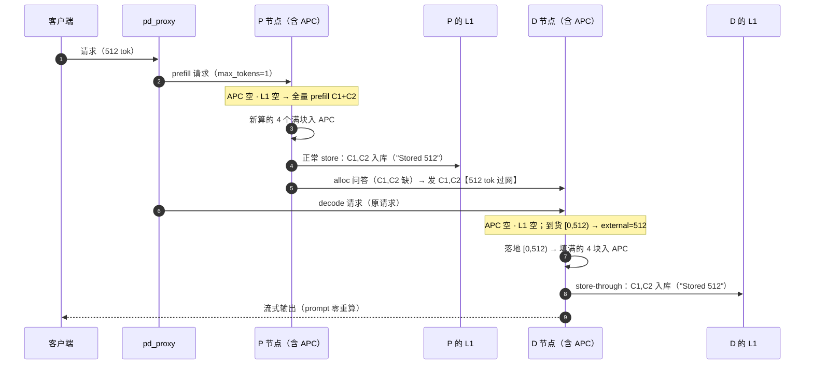
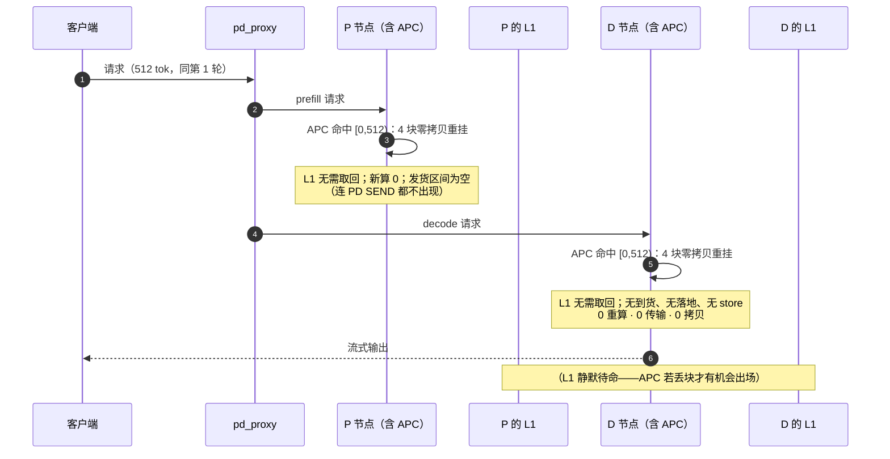
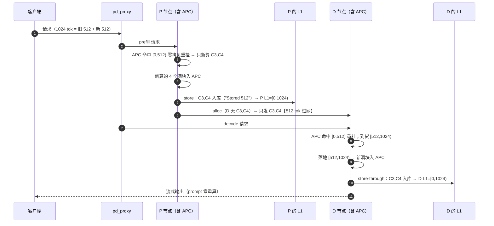
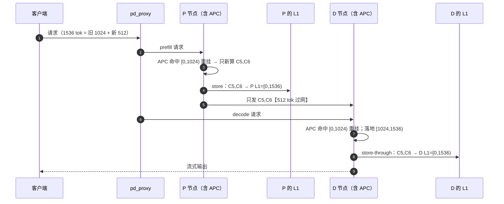
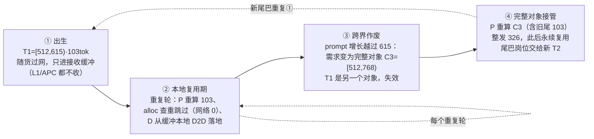
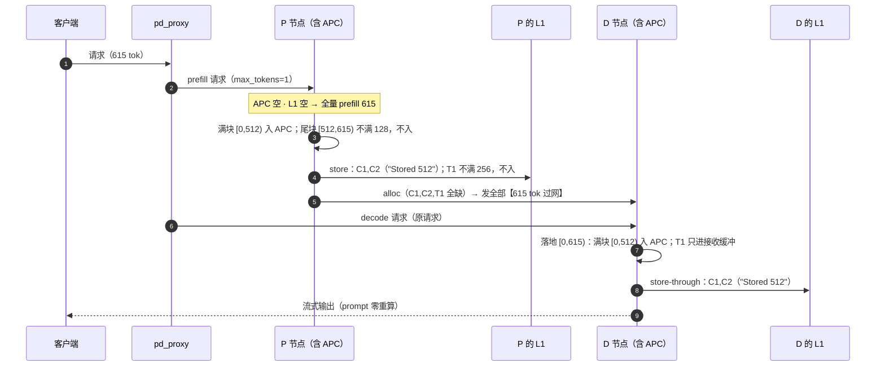
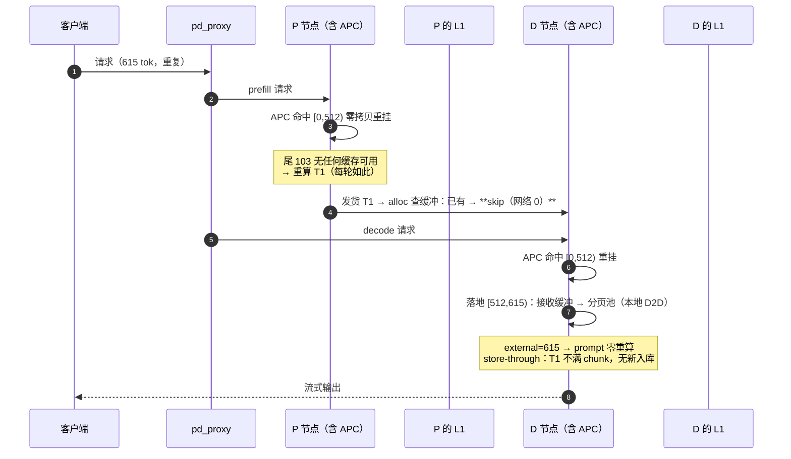
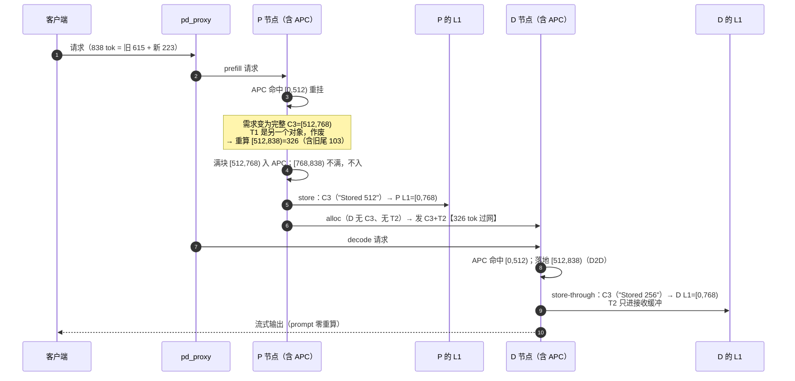
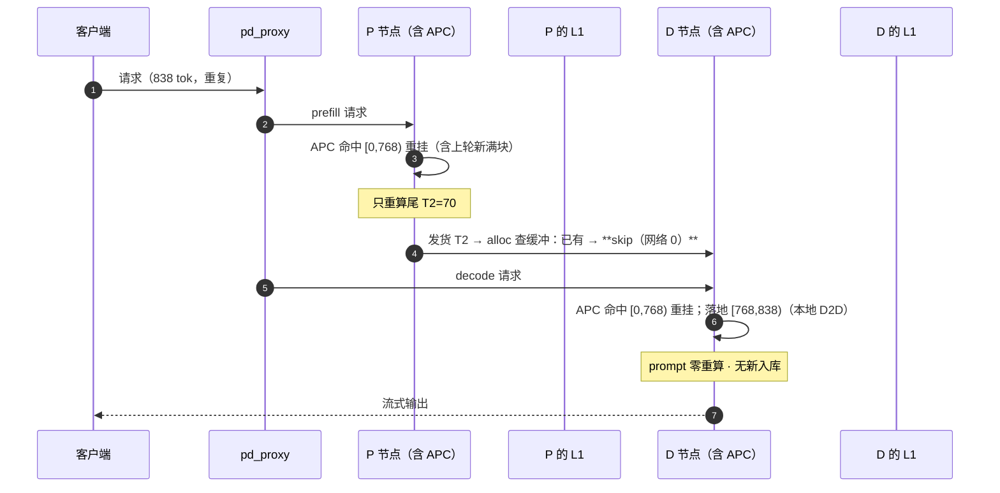

# 四轮复用全时序

> 设定：chunk=256、block=128，prompt 序列 **512 → 512 → 1024 → 1536**（全部落在 chunk 边界）。
> 记号：`C1=[0,256) … C6=[1280,1536)`；APC = vLLM 引擎内分页池的满块缓存（128 粒度），
> L1 = lmcache server（256 粒度），PD = 本 fork 的传输链路。

## 0. 命中的优先级：三段接力

账本段解析固定为 **APC ＞ L1 ＞ PD**，external = 三段接力覆盖的终点：

```
[0, apc)      APC 段：分页池满块零拷贝重挂（不发生任何数据移动）
[apc, l1)     L1 段 ：server 取回 → 拷入本请求新块
[l1, pd)      PD 段 ：接收缓冲落地（D2D）→ 本请求新块
[pd, prompt尾) 重算段：本请求自算
```

**三段各自的性格**：APC 最快但易失（分页池 LRU/抢占可随时丢块）；L1 稍慢
（一次取回拷贝）但持久；PD 传输一次性。APC 丢块时 L1 无缝兜底——命中深度
不变，只是该段从"零拷贝"退化为"取回拷贝"。

## 1. 四轮速览

| 轮 | prompt | P：APC命中→新算 | P 存 L1 | **PD 网络** | D：APC命中→L1命中→落地 | D 存 L1 | 轮后 L1 |
|---|---|---|---|---|---|---|---|
| 1（冷） | 512 | 0 → C1C2 | C1C2 | **512** | 0 → 0 → [0,512) | C1C2 | 双方 `[0,512)` |
| 2（重复） | 512 | 512 → **0** | 无 | **0** | 512 → （无）→ 无 | 无 | 不变 |
| 3（+512） | 1024 | 512 → C3C4 | C3C4 | **512** | 512 → （无）→ [512,1024) | C3C4 | 双方 `[0,1024)` |
| 4（再+512） | 1536 | 1024 → C5C6 | C5C6 | **512** | 1024 → （无）→ [1024,1536) | C5C6 | 双方 `[0,1536)` |

---

## 第 1 轮：冷启动（512 = C1+C2）



## 第 2 轮：完全重复（512）—— 全零拷贝形态



## 第 3 轮：增量 prompt（512 → 1024，新增 C3+C4）



## 第 4 轮：再增量（1024 → 1536，新增 C5+C6）



---

## 2. 规律总结

1. **阶梯同步**：每轮末 P 与 D 的 L1 覆盖一致（P 靠正常 store，D 靠
   store-through）；APC 的覆盖与其同深度（128 粒度更细）。
2. **每个 chunk 只过网一次**：累计网络量 = 最终 prompt 量。
3. **重复轮零成本、且是全零拷贝**：APC 重挂使 L1 取回也被省掉
4. **APC 与 L1 的分工**：APC = 快车道（易失，块随时可能被 LRU/抢占逐出）；
   L1 = 持久仓库（兜底，APC 丢失时同一深度降级为"取回拷贝"，服务不降）。

---

# 不完整尾块场景：四轮复用时序（APC 开启）

> 设定：chunk=256、block=128，prompt 序列 **615 → 615 → 838 → 838**
> （两次都不齐 chunk 边界——现实对话的常态）。
> 记号：满 chunk `C1=[0,256) C2=[256,512) C3=[512,768)`；
> 尾对象 `T1=[512,615)·103tok`、`T2=[768,838)·70tok`。
> 三条粒度规矩（出处见 `cache-reuse-granularity.md`）：满块才入 APC（128）、
> 满 chunk 才入 L1（256）、**PD 可传部分对象，但只有"同一个对象"可被复用**。

## 0. 尾对象的一生（本文核心概念）



**尾对象的宿命**：永远进不了任何持久缓存，重复轮靠接收缓冲"本地续命"，
一旦 prompt 跨过它的边界就作废——同窗口的完整 chunk 把它（连本带利）
重算重发一次，然后永久接管。

## 1. 四轮速览

| 轮 | prompt | P：APC命中 → 新算 | **PD 网络** | D：APC命中 → 本地落地 | D 新入 L1 |
|---|---|---|---|---|---|
| 1（冷） | 615 | 0 → 615 | **615** | 0 → 615 | C1C2（"Stored 512"） |
| 2（重复） | 615 | 512 → **103** | **0** | 512 → 103（D2D） | — |
| 3（+223 跨界） | 838 | 512 → **326** | **326** | 512 → 326（D2D） | C3（"Stored 256"） |
| 4（重复） | 838 | 768 → **70** | **0** | 768 → 70（D2D） | — |

> 本表即 2026-11-17 17:32 实测会话的观测值（`sent_chunks=0`/`tokens=326`/
> `landed=[512,615)·103` 均在该轮日志中逐字出现）。

---

## 第 1 轮：冷启动（615 = C1+C2+T1）



## 第 2 轮：重复（615）—— 尾对象的本地复用期



## 第 3 轮：增量跨界（615 → 838）—— T1 作废时刻



## 第 4 轮：重复（838）—— 新稳态


---

# 缓存复用的粒度规矩：APC / L1(MP) / PD 三层对照

## 0. 结论速览

| 层 | 复用单元 | 部分（不满）单元能存吗 | 能复用吗 | 证据 |
|---|---|---|---|---|
| **APC**（vLLM 引擎内） | block（本部署 `block_size=128`） | ❌ **只缓存满块** | 只有满块 | vLLM 官方设计文档，见 §1 |
| **L1**（LMCache server，MP 模式） | chunk（本部署 `chunk_size=256`） | ❌ `num_stored_tokens` 必须整除 chunk | 只有满 chunk | 上游源码，见 §2 |
| **PD**（本 fork 的传输协议） | chunk 对象（内容寻址） | ✅ `save_unfull_chunk=true` 可传部分 chunk | **仅当下一个请求需要的是同一个对象**（同 token、同边界） | 本 fork 源码 + 实测日志，见 §3 |

---

## 1. APC 层：vLLM 的机制（官方文档原文）

来源：vLLM 官方设计文档 <https://docs.vllm.ai/en/latest/design/prefix_caching/>

原文引用（三条，缺一不可）：

> **Note 1: We only cache full blocks.**

> （KVCacheBlock 数据结构注释）
> `block_hash: BlockHash` — *The block hash (**will be assigned when the block is
> full**), and will be reset when the block is evicted.*

> （分配流程）
> *If an allocated block is already full of tokens, we immediately add it to
> the cache block, so that the block can be reused by other requests.*

机制要点（同文档）：

1. **链式哈希**：每块的哈希 = `hash(父块哈希, 本块 token 序列, 附加哈希)`。
   第 N 块的身份由"前缀全部 token + 本块全部 token"唯一决定。
2. **满块才入缓存**：块没填满，哈希就不赋值、不进 cache_blocks 表。
3. **文档示例 Time 3**：请求与已缓存前缀共享 10/14 token，但第 3 块只有 2/4
   token 匹配 → 只命中前 2 块（8 token）。**块内部分匹配 = 整块不命中。**

为什么满块才可哈希——正确性推导：部分块的内容依赖"请求在哪里结束"这一
请求级信息；若把 103-token 的部分块挂进哈希表，任何在同窗口有更多 token
的请求都会按链式哈希查到**另一个**键（不会误命中，这点 vLLM 做对了），
但反过来它自己也永远查不到别人部分填的块。vLLM 的取舍：**直接不缓存部分块**。

节点部署版本源码核对（自助取证）：

```bash
V=$(python3 -c "import vllm,os;print(os.path.dirname(vllm.__file__))")
grep -n "when the block is full\|is_full\|full_block_hash" $V/v1/core/kv_cache_utils.py | head
```

---

## 2. L1 层（MP 模式）：上游 LMCache 的机制

来源一：上游 `lmcache/integration/vllm/lmcache_mp_metadata.py` L240-267
（`GetStoreMetadata`，每次生成 store 工单的入口）：

```python
def GetStoreMetadata(tracker, lmcache_tokens_per_chunk, group_tokens_per_block, ...):
    """
    ...
    Returns:
        Metadata for newly storable chunks, or None when
        no complete permitted chunk is available.   # ← 没有完整 chunk 就不存
    """
    # NOTE: the invariant here is that `num_stored_tokens` should
    # always be a multiple of `lmcache_tokens_per_chunk`          # ← 整除不变量
```

来源二：上游 `lmcache/integration/vllm/lmcache_mp_connector.py` L1415：

```python
assert ret % self.scheduler_adapter.lmcache_tokens_per_chunk == 0
```

来源三：本 fork 连接器执行同一条规矩（store-through 注入，`L1004`）：

```python
store_end = landed // mp_chunk * mp_chunk          # 尾巴向下取整到整 chunk
```

机制要点：

1. server chunk 键 = **从 token 0 起的滚动哈希 + 固定绝对窗口** `[k×256,(k+1)×256)`，
   窗口与请求长度无关。
2. 若允许存 103-token 的部分对象，它必须挂在 `[512,768)` 窗口键下；下一个在该窗口
   有完整 256 token 的请求会查这个键——取回一个盖不住窗口的对象 → **正确性事故**。
   上游的选择：**不满的不存**，尾段每次重算（代价小、绝对安全）。

---

## 3. PD 层（本 fork）：唯一支持部分对象的层

来源：`lmcache_ascend/integration/vllm/pd_engine.py` L663-680：

```python
def received_prefix_tokens(self, token_ids: list) -> int:
    """Chunk-aligned prefix length ..."""
    for start, end, key in self.token_db.process_tokens(tokens=token_ids):
        if not self.backend.contains(key):   # ← 按内容键逐对象查
            break
        total = end

def expected_prefix_tokens(self, num_tokens: int) -> int:
    if self.save_unfull_chunk:
        return num_tokens                    # ← 部分 chunk 也算到货
    return num_tokens // self.chunk_size * self.chunk_size
```

机制要点：

1. PD 的记账单位是**内容寻址的 chunk 对象**：键由该对象实际携带的 token 推导。
   `[512,615)`（103 tok）和 `[512,768)`（256 tok）是**两个不同对象**——
   键不同、页大小不同、缓冲条目不同。
2. `save_unfull_chunk=true` 时部分对象可以传（让 D 少算尾巴）。
3. **部分对象的复用只发生在"下一个请求需要同一个对象"时**——即完全相同的
   prompt 重复。一旦 prompt 增长跨过旧边界（615 → 838），需求变成完整对象
   `[512,768)`，旧部分对象作废，必须整发。

实测事实（2026-11-17 17:32 会话，615 → 615 重复 → 838）：

| 请求 | P 侧日志 | 语义 |
|---|---|---|
| 615 重复 | `PD XFER ... total_chunks=1 sent_chunks=0 skipped_chunks=1` | `[512,615)` 部分对象命中，网络零字节 ✅ |
| 838（+223） | `PD XFER ... total_chunks=2 sent_chunks=2` | `[512,768)` 完整对象是**新对象**，整发 326 ✅（不是打印问题） |
