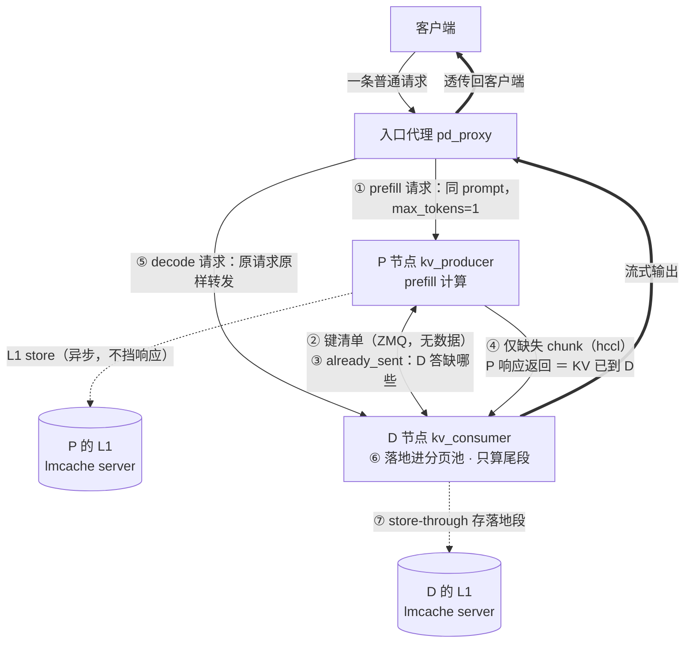
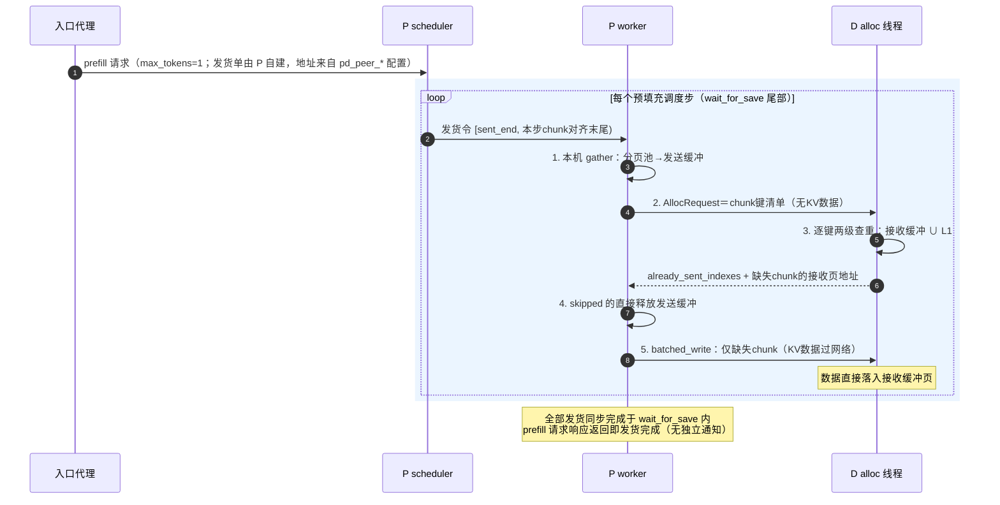
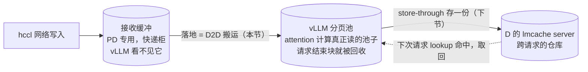
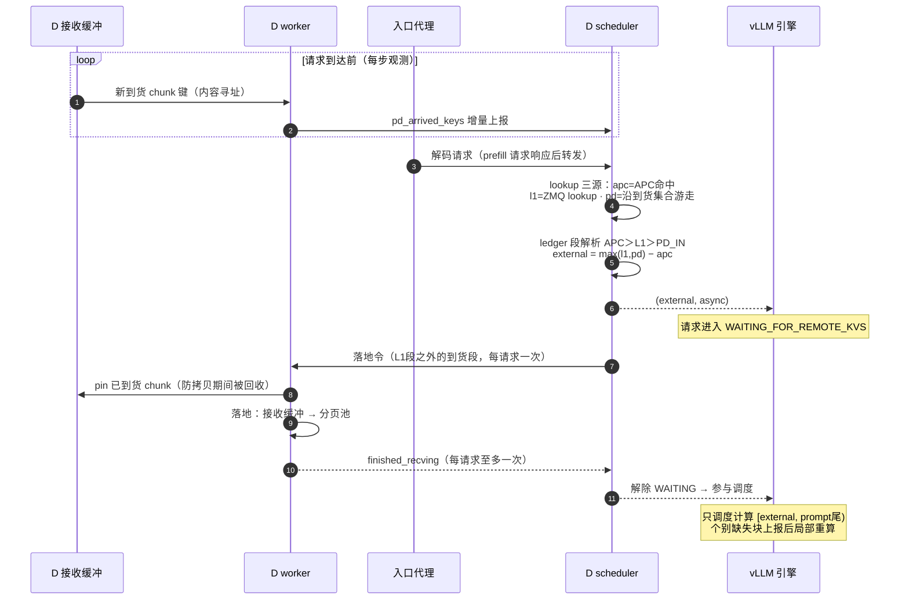
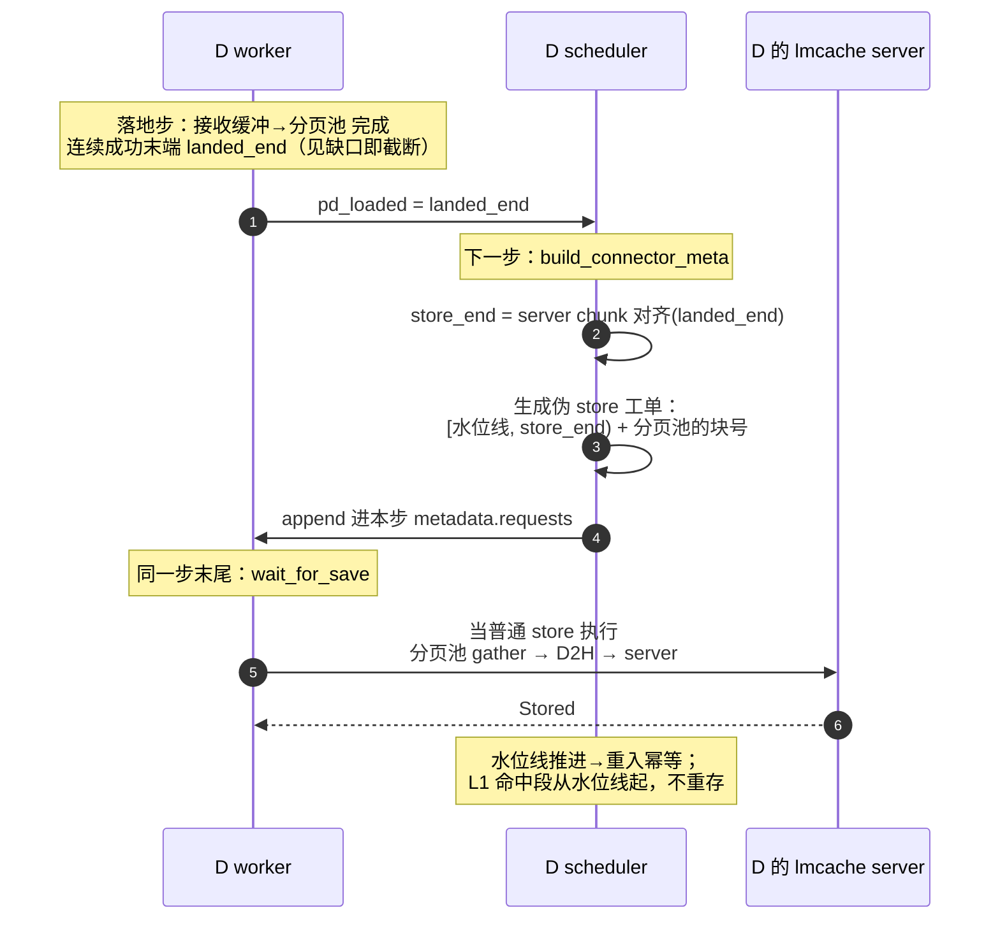
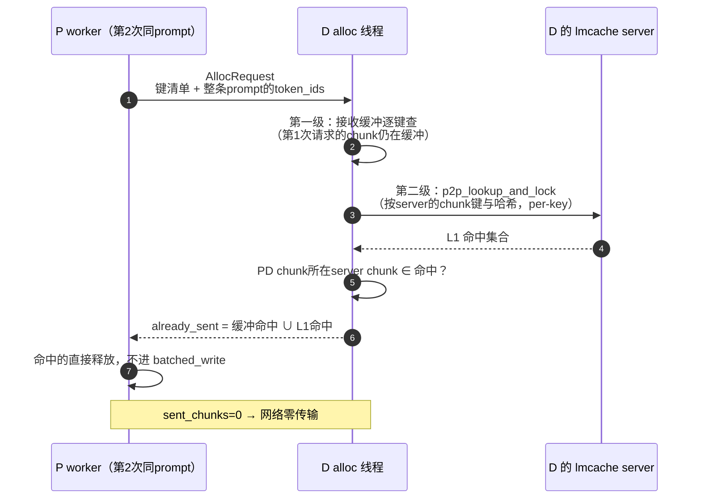
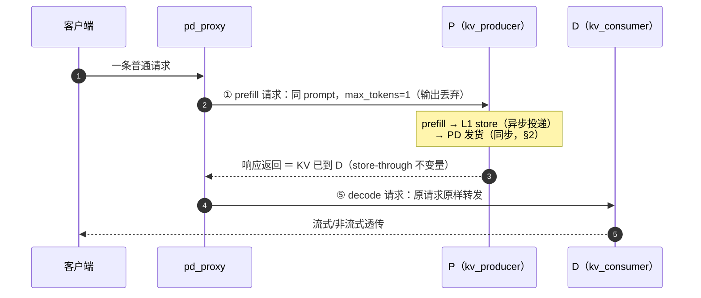

# MP_PD_connector：功能与流程

## 1. 功能总览

| # | 功能 | 作用 | 生效时机 |
|---|---|---|---|
| F1 | **PD 传输**：P 把算好的 KV 按 chunk 推送到 D 的接收缓冲 | D 不必重算 P 已算的前缀 | P 每个 prefill 步 |
| F2 | **三源合并调度**：D 把 APC / L1 / PD 到货三种前缀覆盖合并，只为尾部调度计算 | D 少算 | 每个解码请求 lookup 时 |
| F3 | **store-through**：D 把 PD 落地进分页池的 KV 存入 D 自己的 L1 server | 相同 prompt 再来时，D 的 L1 直接命中 | 落地成功后的下一个调度步 |
| F4 | **alloc 查 L1**：P 发货前 D 检查自己的 L1，已有的 chunk 应答"已收到"，P 跳过传输 | 相同 prompt 再来时，P 网络传输量≈0 | P 每次 alloc 请求 |

**端到端效果（同 prompt 连发两次以上）**：第 1 次全量传输 + D 只算尾 token + 落地段存入 D 的 L1；第 2 次起 D 的 lookup 命中 L1、alloc 应答 already_sent，网络传输 ≈ 0（取决于 store-through 的覆盖与完成时效）。任何一环失效都退化为"重算/重传"，正确性不受影响。

### 组件与数据通路总图



一条请求的生命周期：**①** prefill 请求进 P 预填充 → **②③④** 键清单预检一问一答，只传缺失 chunk（P 响应返回即传输完成，KV 永远先于解码请求到 D）→ **⑤** decode 请求原样转发 → **⑥** D 落地进分页池、只算尾段 → 输出经代理回传。两次 L1 store 都在主干旁：P 侧异步存自己的 L1（不挡响应），D 侧 **⑦** store-through 把落地段存进自己的 L1。任何一环失效都退化为重算/重传，正确性不受影响。各环节内部机制见 §2~§5 分图。

## 2. F1：P → D 的 KV 传输

**协议是"键清单预检"三段式**：P 先本机 gather（分页池→发送缓冲，不过网络）→ 发键清单给 D 预检 → 只对 D 缺失的 chunk 走网络。



要点：

- **区间不重不漏**：`sent_end` 游标推进，多步 prefill 每步只发新增段；P 自己 L1 命中的前缀也在分页池、一并随货。
- **网络只传缺的**：判断发生在任何 KV 字节出网卡之前（alloc 问答）；`PD XFER sent/skipped` 日志即第 4/5 步的计数。
- **无闸门**：完成信号不靠单独通知——P 的响应返回时发货已同步完成（`wait_for_save` 内）；D 侧对部分到货有界等待（`pd_pending_timeout`，默认 3s），超时 fail-closed 重算。
- **内容寻址**：chunk 键由三方（P 发送端 / D 接收端 / D scheduler）从 token 派生，解码请求不携带发货单也能匹配到货。

## 3. F2：D 侧三源合并调度（少算）

### 先厘清：D 节点上 KV 数据的三个"家"

后面所有流程都是在三个家之间搬运：



- **落地（接收缓冲→分页池）**：hccl 只能写进注册好的接收缓冲；vLLM 分页池是引擎自管的，外部写不进。而模型只读分页池——数据到了快递柜还不算数，必须搬进屋。
- **store-through（分页池→L1）**：接收缓冲会被新数据挤掉、分页池在请求结束后被回收，只有 L1 能跨请求存活。

### 流程



例：`apc=512, l1=1024, pd=1536` → 段 `[0,512)=APC | [512,1024)=L1 | [1024,1536)=PD_IN`，external=512，D 只算 `[1536, 尾)`。

释放规则（防崩溃/卡死）：`finished_recving` 至多报一次，且仅当 PD 落地是该请求唯一的释放信号（L1 RETRIEVE 在途则不重复报）；请求被引擎重置后重新 lookup 直接返回"全重算"。

## 4. F3：store-through（D 把落地数据存进自己的 L1）

**动机**：upstream 的 store 只服务"本机算出来的 KV"，D 侧开关干脆是关的——于是 PD 搬来的 KV 在接收缓冲和分页池里都是临时的，请求一结束就没了，L1 里永远是空的。store-through 补上分页池→L1 这一搬：**替 PD 搬来的数据伪造一张与正常 store 同格式的工单**，塞进 store 队列，worker/server 零改动地执行。

用具体数字走一遍（prompt=800，chunk=256，APC/L1 命中 0，PD 到货 `[0,512)`，D 只算 `[512,800)`）：

| 时刻 | 发生什么 | 数据状态 |
|---|---|---|
| 落地步 | worker 落地 2 个 chunk（接收缓冲→分页池），实测**连续成功**末端=512，上报 `pd_loaded=512` | 分页池里 `[0,512)` 是真数据 |
| 下一步·注入 | scheduler 生成伪 store 工单：`STORE [0,512)` + 分页池的块号，append 进本步 store 队列；水位线 0→512 | 工单排队 |
| 同一步末尾·执行 | worker `wait_for_save` 把它当普通 store 执行：分页池 gather → D2H → server | L1 从此有 `[0,512)` |
| 第 2 次同 prompt | D 的 lookup 命中 `[0,512)`，该段无需 PD | — |



三个关键点：

- **只存"连续成功落地"的前缀**：落地失败的块里是垃圾数据，存进 L1 会毒害后续所有命中该 chunk 的请求——账本见缺口就截断（`pd_loaded` 与到货观测 `pd_received` 的区别正在于此）。
- **满 server chunk 才存**：对齐 server 的 chunk 粒度；PD chunk 与 server chunk 配平则全覆盖。
- **水位线 `num_stored_tokens`**：记"已存到哪"，接续存储、不重存；也是 upstream 的既有不变量。

## 5. F4：alloc 查 L1（P 不重传 D 已有的 chunk）

本节是 F1 时序图第 3 步（两级查重）的放大。**D 的 alloc 线程对键清单里的每个 chunk，按顺序查以下两个地方，任一命中即应答 `already_sent`（P 不传输）：**

| 顺序 | 查哪里 | 里面是些什么数据 | 匹配粒度 | 开销 |
|---|---|---|---|---|
| 第一级 | **① 接收缓冲**（本机 PD 内存池，内容键记账） | 任何**历史发货**落下的 chunk：本请求更早步骤发的、以及**更早请求**发过的相同内容（prompt 前缀重叠）——只要还没被缓冲压力淘汰 | PD chunk 键**精确匹配**（按 token 内容派生的键逐个比对） | 本机 dict 查找 + pin，微秒级 |
| 第二级 | **③ D 的 lmcache server**（F4 新增，仅当消息携带 token 上下文且 oracle 已接线） | store-through 存入的 KV（第二次请求起生效） | **server chunk** 粒度：PD chunk 所在的 server chunk 在 L1 命中即整块覆盖 | 约 3 次 ZMQ RPC，毫秒级 |

**不查的地方**（避免误解）：

- ② vLLM 分页池——hccl 根本写不进它，且请求结束后块就被引擎回收，对"要不要收新数据"没有判断价值；
- P 的 lmcache server——在另一台节点，D 的 alloc 线程够不着（P/D 各自的 L1 互不可见，这正是 F4 存在的原因）；
- APC——引擎内部前缀缓存，同理不参与收货决策。

两级都未命中的键才分配接收缓冲页。任何一级的失效语义：第一级永远可用（本机）；第二级整体 fail-open——无 oracle、消息不带 token（旧版 sender）、查询超时/异常/哈希配置失配，一律当作"没有"，P 照常传输，行为与特性关闭时完全相同。

第 2 次同 prompt 请求时，③ 已有第 1 次 store-through 存入的数据：



自洽性：alloc 查的与 D scheduler lookup 查的是**同一个 server、同一套键**——alloc 说"L1 有"，lookup 必然命中，该段由 L1 承接，不会出现"P 没传、D 也没命中"的空洞。L1 淘汰的窗口内误报"已有" → lookup miss → 该段重算，仅浪费一次计算。

## 6. 相关开关（随文）

| 开关 | 默认 | 控制 |
|---|---|---|
| `pd_save_policy` | `both` | P 侧行为：`both` / `pd_only`（P 不写自己的 L1）/ `l1_only`（不走 PD 传输，仅存 L1） |
| `pd_store_through` | true | F3 开关 |
| `pd_alloc_check_l1` | true | F4 开关 |
| `chunk_size` | 256 | PD chunk 粒度；须整除 server chunk，建议配平 |
| `pd_pending_timeout` | 3.0s | D 侧对部分 PD 到货的有界等待，超时 fail-closed 重算 |
| `pd_alloc_rpc_timeout_ms` | 10000 | alloc/handshake ZMQ 套接字的收发超时（对端失联可退避而非卡死） |
| `store_async` | 同步（1p1d/hccs 示例已开 `True`） | L1 store 后台化，移出请求关键路径；PD 发货不受影响（仍同步在响应前） |

## 7. 入口代理（pd_proxy）

> 文件：`examples/disagg_prefill/pd_proxy.py`（与 1p1d/、hccs/ 两个拓扑文件夹并列，不挑拓扑），独立 venv 运行（fastapi/uvicorn/httpx）。
> 改编自 upstream `disagg_prefill_mp` 示例，删掉了它的 telemetry 闸门——对我们是多余且致命的（fork 不发 telemetry，`event.wait()` 会永久挂死）。

### 职责：单请求入口，拆成两份请求



### 失败语义（fail-open）

prefill 请求超时（`--prefill-timeout`，默认 300s）或出错：记日志后**照发 decode 请求**。P 侧传输不会被取消——KV 若随后到达，D 的 pending wait 命中；始终未到，D "无到达则不等"、整段重算。服务永不因 P 单点故障而不可用。

### 部署

```bash
python3 -m venv /mnt/nvme1n1/pd-proxy-venv
/mnt/nvme1n1/pd-proxy-venv/bin/pip install fastapi uvicorn httpx
/mnt/nvme1n1/pd-proxy-venv/bin/python examples/disagg_prefill/pd_proxy.py \
    --host 0.0.0.0 --port 9100 \
    --prefiller-host <P_IP> --prefiller-port 8019 \
    --decoder-host <D_IP> --decoder-port 8019
```

1P1D 下完全取代 router（labels/路由逻辑都不需要）；多 P/D 时自带 round-robin。

## 8. 可观测打点速查

按"在哪看"分组，关键字可直接在节点日志 grep。

### A. 请求面（pd_proxy）

| 关键字 | 含义 |
|---|---|
| `Received /v1/... request, id=` | 每条请求入口（代理侧 16 位 id） |
| `prefill leg took %.4fs` | prefill 请求总耗时（prefill 计算 + L1 投递 + PD 发货） |
| `decode first chunk +%.2fms after prefill leg` | decode 请求首字延迟（TTFT 分解） |
| `Prefill leg failed ... decoder will recompute` | fail-open 触发（P 挂/超时） |

### B. P 侧

| 关键字 | 含义 |
|---|---|
| `delivery spec self-built for req` | 发货单自建成功（对端 = `pd_peer_*` 配置） |
| `PD SEND req= range= chunks= tokens=` | 每批发货（pd_engine） |
| `PD XFER req= ... sent_chunks= skipped_chunks=` | F1 计数：网络实发 / 查重跳过（dedup 生效度） |
| `Storing KV cache for %d out of %d tokens` | L1 store 范围（已命中前缀不重存） |
| `[req_id=] Stored %d out of total %d tokens` | store 完成与耗时分解（process/from_gpu/put） |
| `PD peer connection established` | 控制面握手成功（channel + alloc socket） |
| `Alloc RPC ... timed out` / `Peer ... is backed off` | 对端异常 / 熔断退避 |

### C. D 侧

| 关键字 | 含义 |
|---|---|
| `PD transfer complete for req` | worker 观测到货 |
| `PD arrival partial (...); waiting for the rest` | pending 三态之一：部分到货，等待中 |
| `PD arrival still partial ...; failing closed to recompute` | 等待超时 → 重算（降级但正确） |
| `PD LOAD req= landed= chunks_loaded/failed` | 落地结果（接收缓冲→分页池） |
| `MP+PD store-through: storing req` | 伪 store 工单注入（分页池→L1） |
| `[req_id=] Retrieved %d out of %d required tokens` | L1 命中取回 + 耗时/吞吐（GB/s） |
| `was reset after its PD load; failing closed` | 请求被引擎重置后的兜底 |

另有两条**结构化对账**（scheduler↔worker metadata，非日志）：`pd_received`（到货观测）与 `pd_loaded`（连续成功落地前缀）——store-through 只信后者，见 §4。

### D. 控制面 / 背压 / 初始化

| 关键字 | 含义 |
|---|---|
| `PD engine assembled: role= chunk= channel=` | PD 引擎组装参数 |
| `Initialized NPU allocator: %.2f MB` / `PD pull mode enabled.` | 接收缓冲 / 模式初始化 |
| `Pull mode backpressure ... hwm=%d pages` / `Waiting for receivers to drain` | pull 模式背压水位 |
| `TTL expired for pull_id` | 对端疑似崩溃，pin 页回收 |
| `Push-mode: allocation failed at chunk` | D 分配失败回收（P 收到 alloc_failed 后退避） |
| `Waiting for pending async stores before preemption` | store_async 抢占前 drain |
